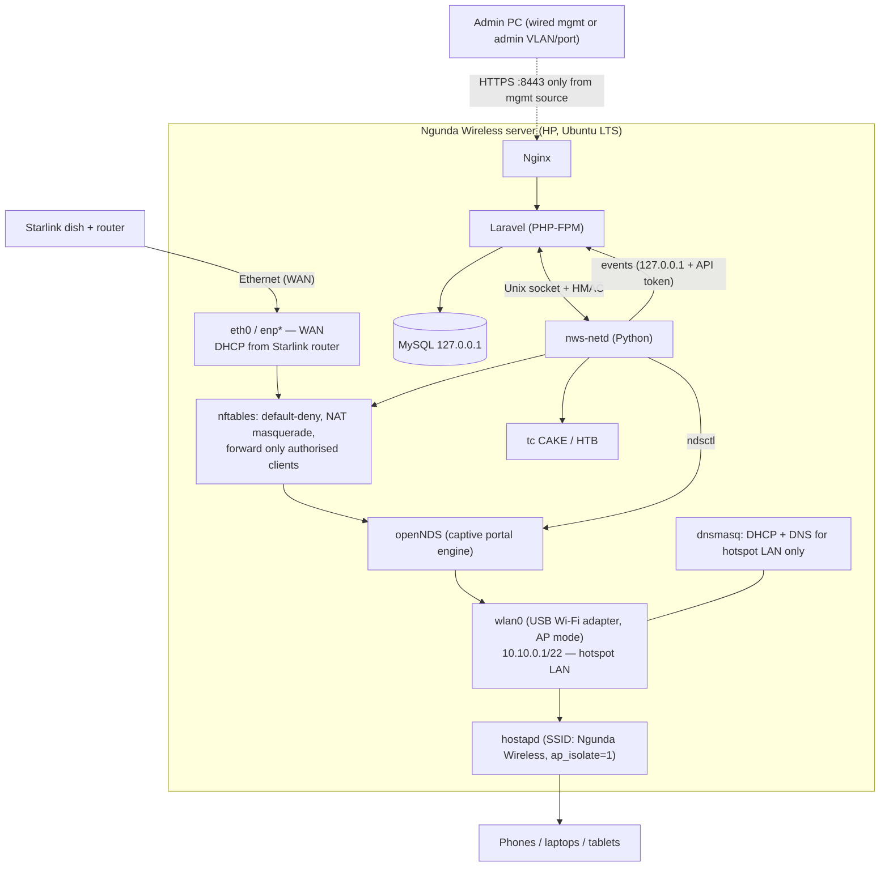
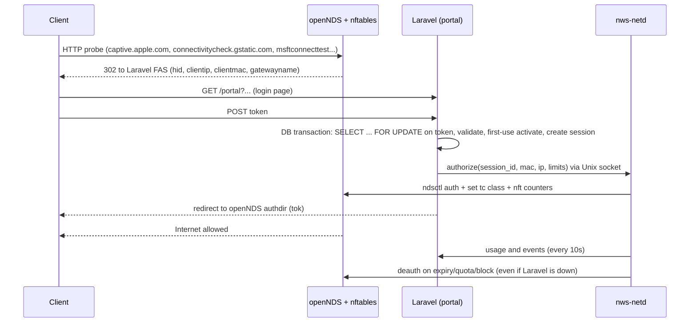
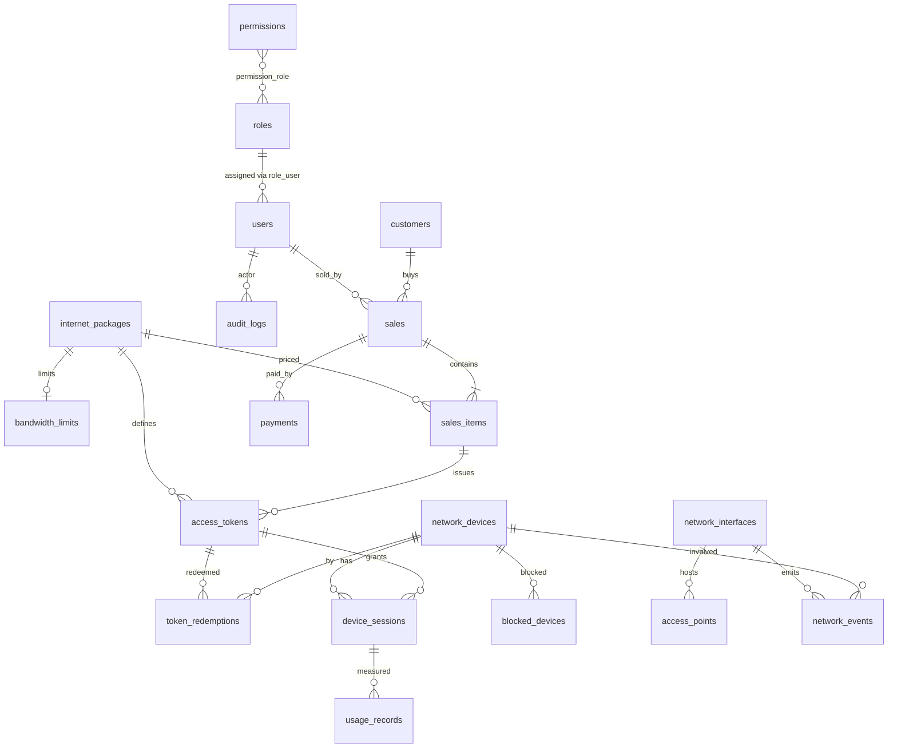

# Ngunda Wireless (NWS) — Phase 1: Architecture & Implementation Plan

Status: **PLAN ONLY. No network changes have been made and none will be made without a backup and your approval.**

> [!IMPORTANT]
> This workspace is on a **Windows** machine, not the HP Ubuntu server. Phase 2 (hardware and Ubuntu assessment) needs a read-only script to be run on the server. It is in `scripts/phase2/assess-ubuntu.sh` (see section 9).

---

## 1. Scope summary (SRS condensed)

| Area | Decision |
|---|---|
| Core app | Laravel 11/12, PHP 8.3, Blade + Bootstrap 5 + Livewire 3, Chart.js |
| Network controller | Python 3.12 service (`nws-netd`), FastAPI over a **Unix socket**, runs as a non-root user with only the capabilities it needs |
| Captive portal | openNDS with **FAS** (Forwarding Authentication Service) pointing at Laravel. Laravel is the token authority, openNDS and nftables enforce. |
| Firewall / shaping | nftables (default-deny), `tc` CAKE (per-client) / HTB (class hierarchy) |
| AP / DHCP / DNS | hostapd (`ap_isolate=1`), dnsmasq |
| DB | MySQL 8 (Ubuntu 24.04 package) |
| Automation | systemd units with `Requires/After` ordering, health-check timer, Bash backup/restore/health scripts |
| Auth for staff | Laravel session auth + 2FA option, `spatie/laravel-permission` for roles |
| Reports | `barryvdh/laravel-dompdf` (PDF), `maatwebsite/excel` (XLSX/CSV) |
| QR / vouchers | `endroid/qr-code`, printable Blade/PDF sheets |

### Functional requirement groups (traceable to your brief)

- **FR-AUTH**: staff login and RBAC (Super Admin, Network Admin, Sales Officer). The Customer role is a captive-portal-only identity with no staff login.
- **FR-TOKEN**: single and bulk generation, secure random codes, time/data/device-limited and promo tokens, first-use activation, revocation, redemption history, vouchers and QR codes.
- **FR-DEV**: live device list from DHCP leases, neighbour table, conntrack and openNDS. Disconnect, block, unblock, replace, limit and history.
- **FR-BW**: package, per-user and global limits enforced with `tc`. Quota exhaustion triggers deauth.
- **FR-SALES**: packages, sales, bulk sales, receipts, cash, mobile money, bank transfer and online payments. Online payments are marked paid only after a verified provider callback and status poll (Paynow-ready interface).
- **FR-REP**: PDF/XLSX/CSV for all 10 report types, with date filters and search.
- **FR-SET**: settings pages. Network changes are validated, backed up and reversible.
- **NFR-SEC / NFR-REL**: see sections 6 and 7.

---

## 2. Network topology



### Addressing (proposed — confirm in Phase 2)

| Item | Value |
|---|---|
| WAN | DHCP from Starlink router (typically 192.168.1.0/24, so double NAT) |
| Hotspot LAN | `10.10.0.0/22` (about 1000 clients), gateway `10.10.0.1` |
| DHCP pool | `10.10.0.50 – 10.10.3.250`, lease 2h |
| Management | Laravel admin on a **separate Nginx listener** (`:8443`) reachable only from the WAN-side admin host or a wired management interface. Never from `wlan0`. |
| Portal | Laravel portal vhost `:80` on `10.10.0.1`, reachable from `wlan0` for the login page and its assets only |

### Traffic policy (nftables, default-deny)

- `input` from `wlan0`: allow only DHCP (67/68), DNS (53) to dnsmasq, the portal vhost, and openNDS ports. **Drop** SSH 22, MySQL 3306, admin 8443, Python socket (not a TCP port at all) and everything else.
- `forward`: pre-auth clients can reach only the portal. openNDS adds authenticated clients to its allow set. Wi-Fi client to client is blocked twice, by hostapd `ap_isolate` and an nft rule `iifname wlan0 oifname wlan0 drop`.
- `postrouting`: masquerade `wlan0 → WAN`.
- **Fail-closed**: if `nws-netd` or openNDS is down, clients stay blocked, not open.

---

## 3. Hardware: key finding to confirm

> [!WARNING]
> Most HP desktops have **one Ethernet port and no Wi-Fi**. You need a WAN NIC **and** an AP-capable Wi-Fi radio. The Starlink dish takes the Ethernet port, so a **USB Wi-Fi adapter with reliable AP mode is almost certainly required**.

Recommended adapter families (in-kernel drivers, good hostapd support). **Verify with `iw list` before buying and again after plugging in**:

| Chipset | Notes |
|---|---|
| MediaTek **MT7612U** / MT7610U (e.g. Alfa AWUS036ACM) | In-kernel `mt76x2u`. Stable AP mode and dual-band. **First choice.** |
| MediaTek MT7921AU (Wi-Fi 6) | Works with recent kernels. Check AP mode in `iw list`. |
| Avoid | Realtek 8812AU/8821CU and similar. They need out-of-tree DKMS drivers, which break on kernel updates and are bad for unattended recovery. |

Expect about 20–40 comfortable concurrent clients from one USB adapter. For more, plan a second adapter or a wired AP in bridge mode. That second option weakens `hostapd` control, so it would be a design change you'd need to approve.

Also needed: BIOS **Restore on AC Power Loss / Power On after AC Loss = Power On**, and a UPS. It is strongly advised for Starlink power cuts and for protecting the filesystem.

---

## 4. Key integration design

### 4.1 Authentication flow (openNDS FAS + Laravel + nftables)



- openNDS handles Android, iOS, Windows and Linux probes. Plain HTTP interception is the standard method, and HTTPS probes fail safely.
- Session identity is the **openNDS client token + session id + MAC + IP**. The MAC alone is never trusted.
- **Randomized/private MACs**: detect the locally-administered bit and tag the device. Device limits count **authenticated sessions per token**, not unique MACs. A token redeemed on a new MAC counts against the limit and is subject to "replace device".
- Open item for Phase 3: confirm the openNDS build (source vs package) on Ubuntu and that it uses **nftables**. This is the recent openNDS 10.x behaviour, to be verified on the real install. Also confirm which FAS security level the installed version supports.

### 4.2 Laravel ↔ Python (no web-exposed root)

- Python runs as `nws` (not root) with `AmbientCapabilities=CAP_NET_ADMIN CAP_NET_RAW`. Where `ndsctl` or `tc` need privilege, a **fixed allow-list of operations** is implemented in Python. There is **no generic "run command" endpoint and no `shell=True`**. Inputs (MAC, IP, rates) are strictly validated.
- Laravel → Python: HTTP over a **Unix socket** (`/run/nws/netd.sock`, mode 0660, group `nws-api`), plus an HMAC-signed request with timestamp and nonce, plus `SO_PEERCRED` check on the caller's UID.
- Python → Laravel: `127.0.0.1` only, with a scoped API token for event/usage sync, with a retry queue.
- **Local state**: Python keeps a small SQLite file of active grants (expiry, quota, rates). Enforcement therefore **keeps working and recovers after reboot even if MySQL or Laravel is down**.
- Python checks time and quota expiry itself every few seconds, and Laravel's scheduler reconciles.

### 4.3 Bandwidth

- Per-package rates are passed to openNDS and mirrored in `tc`. We do **not** depend on openNDS's own shaping, because it assumes OpenWrt tooling (SQM). `nws-netd` owns the shaping.
- WAN egress: CAKE (`diffserv4`, `nat`) for fairness, with a configurable global ceiling. Per-client limits use per-IP HTB classes or `tc` + ifb for ingress. The final choice is made after Phase 3 testing on the real adapter.
- Data accounting: nftables per-client counters, polled by Python and written to `usage_records`. When the quota is exceeded, Python deauths and sets the token to `exhausted`.

### 4.4 Token security

- Format: `XXXX-XXXX-XX` from an unambiguous 32-char alphabet (about 50 bits) via `random_int`. Longer is configurable.
- Storage: `HMAC-SHA256(code, server pepper)` for lookup (unique index). An **encrypted** copy exists only while the batch is unsold/printable, then is purged.
- Redemption: `DB::transaction` + `SELECT ... FOR UPDATE` + a unique constraint on active redemption. Rate limiting is per IP/MAC with lockouts, and failures are audited.

### 4.5 Payments

- A `PaymentProvider` interface with `CashProvider`, `MobileMoneyManual`, `BankTransfer` and `PaynowProvider` (stub for later).
- Online payments: `pending → paid` **only** after a server-side verified provider callback plus a status poll. A client redirect alone never marks a payment paid.

---

## 5. Database design (20 required tables)



Beyond the 20 required tables I plan to add only the supporting tables the framework needs: `role_user`, `permission_role` (or spatie equivalents), `token_batches` (bulk/print/QR tracking), `personal_access_tokens`, `jobs`, `failed_jobs`, `sessions`, `cache`.

Conventions: `bigint unsigned` PKs, `utf8mb4`, `decimal(12,2)` for money (with a currency column), UTC timestamps, FKs with `ON DELETE RESTRICT` for financial/audit data, and soft deletes only where history matters. Key indexes: `access_tokens(code_hash UNIQUE, status, expires_at)`, `network_devices(mac)`, `device_sessions(status, ends_at)`, `usage_records(session_id, recorded_at)`, `audit_logs(created_at)`.

---

## 6. Security model

| Layer | Controls |
|---|---|
| Application | Hashed passwords (Argon2id/bcrypt), RBAC gates and policies, CSRF, FormRequest validation, Eloquent parameter binding, throttling, 2FA option, audit log on every sensitive action |
| API | Sanctum/scoped tokens for REST, HMAC for Laravel↔Python |
| Server | Non-root services, systemd hardening (`NoNewPrivileges`, `ProtectSystem`, `PrivateTmp`), MySQL on 127.0.0.1 with a dedicated user, secrets in `/etc/nws/*.env` mode 0640, SSH keys only, `fail2ban` |
| Network | nftables default-deny, client isolation, separate admin listener, no hotspot access to SSH/MySQL/admin |

---

## 7. Reliability and power-loss recovery

systemd ordering (all `enabled`, `Restart=on-failure`, `StartLimitBurst` set):

```
network-online.target
  → mysql → php-fpm / nginx
  → nws-firewall (nftables rules, ip_forward, NAT)
  → hostapd → dnsmasq → opennds
  → nws-netd (restores grants from SQLite, rebuilds tc/nft state)
  → nws-health.timer (checks each service and WAN every 30s, controlled restarts)
  → laravel scheduler (cron/timer)
```

- BIOS: Power On after AC Loss, with a UPS recommended.
- Unattended boot: no login prompt needed (services, not user sessions). Auto-login is **not** required.
- **Full-disk encryption** blocks unattended boot because it needs a passphrase at every boot. Options: (a) don't encrypt the OS disk and encrypt only the sensitive data and backups, which is **recommended** for an unattended gateway; (b) TPM2 auto-unlock (`systemd-cryptenroll`), which depends on the hardware having a TPM; (c) network-bound unlock (Clevis/Tang), which needs another always-on host. Decide before installation, because it is hard to change later.
- Backups: nightly `mysqldump` (`--single-transaction`), a config backup of `/etc/{hostapd,dnsmasq.d,opennds,nftables.conf,nws}`, 14-day rotation, an off-box copy option, a tested `restore.sh`, `logrotate` and a disk-space alert (80%/90%).

---

## 8. Phased plan with exit gates

| Phase | Deliverables | Exit gate (tested before moving on) |
|---|---|---|
| **1** Requirements & architecture | This document, the ER diagram and topology | **You approve this plan** |
| **2** HW/Ubuntu assessment | `assess-ubuntu.sh` report, adapter AP-mode verdict, `backup-network-config.sh` | Report reviewed. AP-capable radio confirmed. Backup of current config exists. |
| **3** Network infra | Netplan WAN/LAN, hostapd, dnsmasq (resolved stub conflict handled), nftables, NAT, openNDS install | A phone joins, gets DHCP, is redirected to a test portal and reaches the internet only after auth. Isolation proven. Rollback tested. |
| **4** Laravel app | Auth, RBAC, dashboard shell, migrations (20 tables), packages, settings | Feature tests pass. Migrations run on MySQL. |
| **5** Token auth | Generation (bulk/promo/device-limited), redemption with locking, portal, QR/print | Valid, invalid, expired, duplicate and concurrent-redemption tests pass. Live phone login. |
| **6** Network mgmt | `nws-netd`, device detection, block/disconnect, tc limits, quota and expiry enforcement | Python integration tests on the real gateway. A blocked device really loses internet. A speed test confirms the limit. |
| **7** Sales/payments | Sales, receipts, payment providers, financial reports | Payment state machine tests. No unverified "paid". |
| **8** Monitoring/analytics | Live dashboard (real data only), Chart.js, PDF/XLSX/CSV reports | Reports match DB totals. Dashboard values match `ip`/`nft`/`tc` output. |
| **9** Security/reliability | Pen-test checklist, fault injection (WAN down, service kill, reboot, power-pull), backup restore | All section-17 scenarios pass. |
| **10** Production | Deployment script, systemd units, docs, runbook | A cold power-off/on returns to a working hotspot with no human input. |

### Planned repository layout

```
ngunda wireless/
├─ docs/                    # SRS, architecture, runbooks, config docs
├─ laravel/                 # Laravel app (modular: app/Modules/{Auth,Tokens,Devices,Bandwidth,Sales,Reports,Settings})
├─ netd/                    # Python service (nws_netd/, tests/, pyproject.toml)
├─ system/
│  ├─ systemd/              # *.service, *.timer
│  ├─ nftables/             # nftables.conf
│  ├─ hostapd/ dnsmasq/ opennds/ netplan/
│  └─ scripts/              # backup.sh, restore.sh, healthcheck.sh, install.sh
└─ scripts/phase2/          # assess-ubuntu.sh, backup-network-config.sh
```

---

## 9. Phase 2 — what I need from you

Run these **on the Ubuntu server** (read-only; the first script changes nothing):

```bash
bash assess-ubuntu.sh        # writes ~/nws-assessment-<date>.txt
```

Paste the report back to me. `backup-network-config.sh` copies current network config to `/var/backups/nws/` and is the only script that writes anything. Run it only after you've reviewed it.

### Decisions I need from you

1. **Ubuntu version** on the server (22.04 vs 24.04 LTS), and whether it's already installed or still to be installed?
2. **Wi-Fi adapter**: do you already own one? Model or `lsusb` output?
3. **Starlink router**: will you leave it in router mode (double NAT, simplest) or use bypass mode?
4. **Admin access path**: wired admin PC on the WAN side, or a second wired port?
5. **Disk encryption**: skip OS-disk encryption (recommended for unattended recovery) or use TPM2 unlock?
6. **Currency and payments**: USD/ZWG? Which of cash and mobile money (e.g. EcoCash) do you need first? Paynow comes later.
7. **Hotspot subnet**: is `10.10.0.0/22` acceptable, i.e. no clash with the Starlink router's range?
8. **Branding**: logo, support phone/WhatsApp, terms text. Placeholders are fine for now.
9. **Dev workflow**: build here and deploy to the server, or develop directly on the Ubuntu box via SSH?

> [!NOTE]
> Hotspot code is only partly testable without the real gateway (Phases 3, 6 and 9 require the physical server). Laravel (Phases 4, 5, 7 and 8) can be built and tested here or in a Linux VM.
